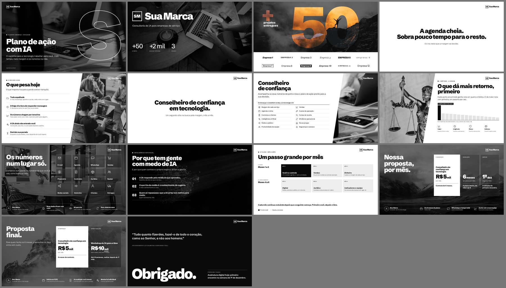

# Apresentação em PDF bonita

Uma skill para o Claude montar uma apresentação comercial bonita em PDF, com a sua marca e as suas
informações. O Claude te entrevista, uma pergunta por vez, preenche o conteúdo e gera o PDF.



O PDF de exemplo, com 14 páginas, está em [docs/exemplo.pdf](docs/exemplo.pdf).

## O que sai

- Uma apresentação 1920x1080 em preto e branco, com fotos de fundo, ícones e tipografia forte.
- Capa, números da empresa, número de destaque com a foto dentro, faixa de logos de clientes, lista
  do que pesa hoje, temas, método, cronograma mês a mês, caixas de preço e o "Obrigado." no fim.
- O PDF, o HTML que gerou ele e, se quiser, um PowerPoint para apresentar.

Serve para proposta, plano de ação, apresentação da empresa, oferta de IA para serviços, workshop
ou mentoria.

## Como instalar

Você precisa do Claude no computador (claude.ai/download), com o Claude Code, e do Google Chrome.

Peça ao Claude:

```
Instale para mim a skill apresentacao-pdf-bonita com o comando
npx skills add guimreis/apresentacao-pdf-bonita -g -y
```

Se ele disser que falta o Node.js, deixe ele te guiar na instalação. Depois, abra uma conversa nova.

## Como usar

Numa conversa nova, diga:

```
Quero uma apresentação bonita em PDF para a proposta do meu cliente.
```

O Claude vai perguntar, uma coisa por vez:

1. que material é (proposta, plano de ação, apresentação da empresa, workshop);
2. a sua marca, o site e a logo;
3. os seus números e os clientes que você pode mostrar;
4. o que pesa hoje no cliente e como você resolve;
5. a oferta, o preço e o cronograma;
6. as fotos;
7. o versículo bíblico da última página (ele sugere um).

Ele gera o PDF, confere cada página e te mostra. Você pede os ajustes e ele gera de novo.

Sem a sua logo, sai uma logo provisória com as suas iniciais. Sem logos de clientes, a faixa sai com logos genéricas ("Empresa 1" a "Empresa 12"). Troque antes de
mandar ao cliente.

## Fotos e fonte

As dez fotos que vêm com a skill são do Unsplash (Licença Unsplash, uso comercial livre) e a fonte é a Schibsted Grotesk (SIL Open Font License).
Créditos em [assets/fotos/CREDITOS.md](skills/apresentacao-pdf-bonita/assets/fotos/CREDITOS.md).

## Quem fez

Feito por Guilherme Reis. Ensino empresários e profissionais a trabalhar com IA no dia a dia.

- Instagram: [@guilhermereis.ai](https://www.instagram.com/guilhermereis.ai/)
- Comunidade no WhatsApp, com aula ao vivo toda segunda: [entrar no grupo](https://chat.whatsapp.com/LncD1JNhpog7246d8waj74)

Licença MIT: use, mude e compartilhe à vontade.
